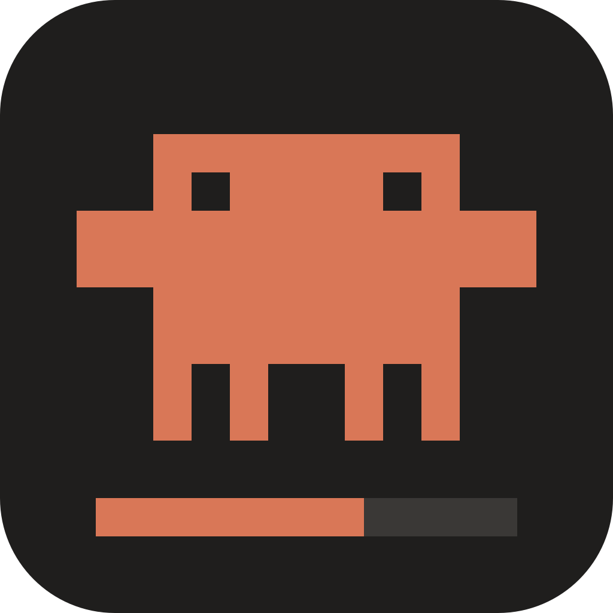
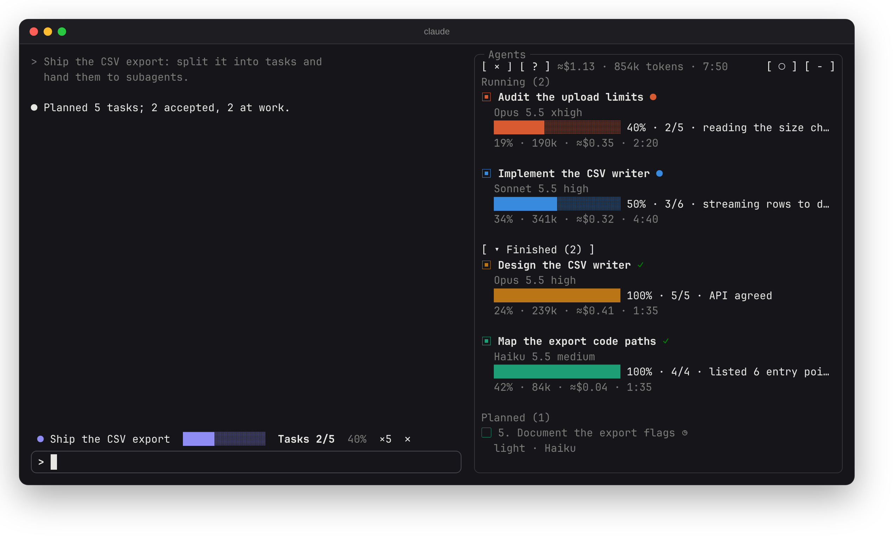
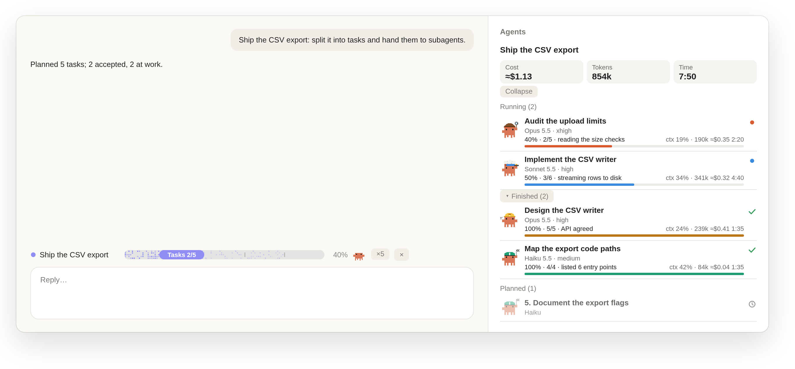

<p align="center">
  
</p>

<h1 align="center">agents-progress</h1>

<p align="center">
  <b>See your subagents work.</b><br>
  A Claude Code mod: a progress band above the prompt and a live pane of every subagent,<br>
  with its model, effort, task progress, context, estimated cost and time.
</p>

<p align="center">
  <a href="LICENSE"></a>
  
  
</p>

<p align="center">
  <b>English</b> · <a href="README.pt-BR.md">Português (Brasil)</a>
</p>

<p align="center">
  
  <br>
  <sub>Laid out from the mod's terminal output for a sample flow; the window around it is a mock-up.</sub>
</p>

## What you get

- **A progress band** above the prompt: the flow's title, its phase, accepted tasks out of planned, and a button with the crew size that opens the pane. It sits under any other plugin's band.
- **An agents pane** (`/agents-info`) that opens by itself when a subagent starts: running, finished and planned runs, each with its model and effort, its own steps, context fill, tokens, estimated cost and time, and totals for the whole session.
- **A color per tier.** Each run takes its tier's color (Fable, Opus, Sonnet, Haiku), so you can read a crew at a glance; in the desktop app it also wears a pixel crab costumed for the tier.
- **Workflow runs** fold into one row you can open, and a run started by another subagent sits indented under it.
- **Terminal and desktop app.** The same rows drawn as text in the terminal and as pictures in the Claude desktop app.
- **English, Portuguese and Russian**, following Claude Code's language setting.

## Install

At the prompt of a Claude Code session in a terminal:

```
/plugin install agents-progress --marketplace fabiopbarbieri/agents-progress
```

Answer `y` to add the marketplace, then pick a scope. Or from a shell:

```bash
claude plugin marketplace add fabiopbarbieri/agents-progress
claude plugin install agents-progress@agents-progress
```

- **Claude Code 2.1.286 or later.** Mods run from 2.1.286 in the desktop app and from 2.1.287 in the terminal (`engines` in `.claude-plugin/plugin.json`; Claude Code reads that range from 2.1.323, and older releases ignore it). Features that came later in Claude Code step aside on an older one; see [Claude Code versions](#claude-code-versions).
- **Desktop app.** It has no `/plugin` command: install from a terminal, and the mod loads in the app's local sessions too.
- **Settings are optional.** The install may say they are not set; their defaults apply until you change them in `/config`.

## How it works

1. Before it delegates, Claude loads the mod's skill and reports the plan through the `progress` tool: a title, the phase and the tasks. The band appears.
2. The mod adds a short paragraph to every subagent's prompt asking it to report its own steps through the `step` tool. The pane shows each run's bar filling as it goes.
3. As Claude accepts each result, it reports it, and the band counts it. When the flow is reported finished, the band steps aside 10 seconds later.

Runs that never call `step`, or work no one planned, still show in the pane: model, context fill (in grey), tokens, cost and time come from the engine itself.

## The agents pane

`/agents-info` toggles it. It opens by itself when any subagent starts, once per busy spell (a run started while none was running) or once per reported flow, so closing it sticks until then. It shows the session's subagents across flows: the running ones, the latest ten finished (a `+N earlier` button opens the rest) and the planned ones. The totals count every run.

- **Open a transcript.** In the terminal, pressing a run's title puts its transcript in the main view, and pressing the run in view brings the main conversation back; `↩ Main conversation` (`m`) does too. The run in view is marked. The desktop app does not switch its main view to an agent, so its pane draws no such press.
- **Nested runs.** A run another subagent started sits right under it, indented.
- **Workflow runs.** A run of the Workflow tool is one row named after the workflow: its agents answered out of started as the bar, with their summed tokens, cost and time. Its `▸` button (the title, in the terminal) opens its agents beneath it, each with its own steps once it reports them. The band counts the run once.
- **Woken runs.** A run that answered and is woken again shows as running from the start of its new turn.
- **Four rows per run** in the terminal: the name; the model and effort (`Opus 5.5 high`); the bar with the task's steps; then the context share, tokens, cost and time.

### Keys

With the pane focused:

| Key | Does | Where |
| --- | --- | --- |
| `c` | Collapse or expand the pane (`[ − ]` / `[ + ]` in the terminal) | both |
| `f` | Fold or unfold the finished runs | both |
| `e` | Open or close the earlier finished runs | both |
| `s` | Simple view: each run keeps only its name and bar (`[ ○ ]`); again for the details (`[ ● ]`) | terminal |
| `m` | Back to the main conversation | terminal |
| `?` | List these keys (the button at the pane's top left) | terminal |
| `Esc` | Close the pane, from the pane or from an idle, empty prompt | both |

Docked in the terminal, the pane's header starts with a `[ × ]` that closes it. Claude Code draws its own close mark in the terminal's top-right corner, where a host that draws its own controls over the terminal (Orca, for one) can hide it. A pane too narrow for both the button and its shortest totals leaves the button out; `Esc` and `ctrl+x x` still close it.

In the terminal the keyed buttons are framed, so no key prefix (`c:`) is drawn before their labels. While a dialog or a field above the prompt covers the prompt, the `?` help says to focus the pane once the prompt is free (Claude Code 2.1.323).

<details>
<summary><b>Narrow panes</b></summary>

A narrow pane keeps its header's buttons whole. From Claude Code 2.1.305 a docked pane stays within 45% of the terminal: 48 columns at 110, 53 at 120.

- The flow's name gives way first, and goes once fewer than 12 cells would show of it, since the band names the flow.
- Then the word `tokens`, the token count and the time.
- A run's last row drops its context tokens before its time.

</details>

### In the desktop app

<p align="center">
  <picture>
    <source media="(prefers-color-scheme: dark)" srcset="assets/desktop-dark.png">
    
  </picture>
  <br>
  <sub>The same flow in the mod's own desktop drawings; the app around them is a mock-up.</sub>
</p>

Each row is a picture there, with a pixel crab whose costume shows the tier. The keys are the same, without `s`, `m` and `?`.

## Tiers

A run's tier picks its color, and in the desktop app its crab. An agent type named after a tier (`careful`, `plugin:careful`) wins; otherwise the model decides:

| Tier | Model | Color |
| --- | --- | --- |
| `fable` | Fable | violet |
| `heavy` | Opus at xhigh or max effort | orange |
| `careful` | Opus below xhigh | amber |
| `medium` | Sonnet | blue |
| `light` | Haiku | green |

The effort is the one each model request ran at, so a run follows `CLAUDE_CODE_SUBAGENT_EFFORT` (Claude Code 2.1.316) when nothing else names a level.

**Heavy tasks at xhigh.** With `heavyEffort` on, a run whose description matches a task planned `heavy` runs each model request at xhigh effort (max stays max), above `CLAUDE_CODE_SUBAGENT_EFFORT` and the session's level, so it shows the `heavy` crab and color. Off by default. It needs Claude Code 2.1.309, and stands aside while `CLAUDE_CODE_EFFORT_LEVEL` forces one level.

## Settings

Set them in `/config`.

| Setting | Values | Default | What it does |
| --- | --- | --- | --- |
| `language` | `auto`, `en`, `pt`, `ru` | `auto` | The pane's language. `auto` follows Claude Code's language setting, then the system locale. |
| `stepBrief` | `on`, `agents`, `off` | `on` | `on` briefs every subagent to report its steps, a workflow's agents included. `agents` briefs only the subagents the Agent tool starts, leaving a workflow script's prompts as written. `off` leaves every prompt as written. Each report is one more model request in the subagent, so a workflow of many agents pays it many times over: pick `agents` to spare it. |
| `heavyEffort` | `on`, `off` | `off` | `off` leaves every subagent's effort as Claude Code picks it; the mod sets no model or effort. `on` runs the subagents of tasks planned `heavy` at xhigh effort, which costs more tokens per request. |

## Tools and skill

| Name | Used by | For |
| --- | --- | --- |
| `mcp__agents-progress__progress` | the delegating session | The plan, the phase and the accepted tasks. |
| `mcp__agents-progress__step` | each subagent | Its own steps (`done`, `total`, `note`). |
| `agents-progress:reportar-progresso` (skill) | Claude, before any delegation | When to call `progress`: the plan first, then each accepted task. It is not in the `/` menu. |

- From Claude Code 2.1.293, `step` is listed from the first prompt, so a subagent calls it without a ToolSearch first. The paragraph the mod adds to each prompt names ToolSearch only on an engine before 2.1.293.
- A workflow's agents get that paragraph from Claude Code 2.1.300. Before it, as in a desktop app whose engine is older, they keep their prompts as the script wrote them.
- A run that does not report its steps shows its context fill in grey.
- Neither tool draws a row in the transcript, since the band and the pane show what they report; a call that failed still shows.

## Good to know

- **Cost is an estimate** from token counts and the `PRICES` table in `hooks/register.tsx`, not a bill.
- **Claude Code's own progress summaries are not used.** The band and the pane draw from the mod's own tools and each run's token counts. To spare the requests that write those summaries, set `CLAUDE_CODE_DISABLE_AGENT_PROGRESS_SUMMARIES=1` (Claude Code 2.1.318).

## Claude Code versions

The mod runs from the floor below. What came later in Claude Code steps aside quietly on an older engine; the desktop app runs its own engine, which can lag behind the CLI.

| Claude Code | What it brings to the mod |
| --- | --- |
| 2.1.286 (desktop) · 2.1.287 (terminal) | Mods run: the band, the pane, both tools and the skill. |
| 2.1.293 | `step` is listed from the first prompt, so subagents skip a ToolSearch. |
| 2.1.300 | A workflow's agents are briefed to report their steps. |
| 2.1.305 | A docked pane stays within 45% of the terminal, and the header fits it. |
| 2.1.309 | `heavyEffort` can raise a `heavy` task to xhigh. |
| 2.1.316 | Runs follow `CLAUDE_CODE_SUBAGENT_EFFORT`. |
| 2.1.318 | `CLAUDE_CODE_DISABLE_AGENT_PROGRESS_SUMMARIES` spares the summaries the mod does not use. |
| 2.1.323 | `engines` is read at install, update and load; the `?` help knows when the prompt is covered; `validate` type-checks the tests. |

## Development

To work on it, add your clone as the marketplace instead (`claude plugin marketplace add <path to the clone>`): the entry's source is relative, so the session reads the plugin from that folder. Edit, then `/reload-plugins`.

### Checks

```bash
claude plugin validate . --strict
claude plugin test .
npx -p typescript@5 tsc -p .
```

- `claude plugin test` runs `tests/*.test.ts` against the engine's own host, on the terminal and desktop surfaces; `tests/kit.ts` stands for the engine beneath the mod. It checks the hooks and the trees they return, not how a surface paints them.
- From Claude Code 2.1.323, `validate` type-checks `hooks/` and `tests/` against the engine's own API types, and `--strict` fails on any type error. `tests/kit.ts` builds full render requests (`BAND`, `PANE`) so the tests pass that check. Run it with 2.1.323 or later: an older CLI warns about the `engines` field it does not know, and `--strict` fails on that warning.
- `scripts/readme-images/build.sh` redraws the pictures in `assets/` from the mod's own output for a sample flow (it needs Python 3, headless Chrome and ImageMagick).
- `tsc` reads the API types the engine lays in `.claude-plugin/types/` (ignored by Git) when an interactive session loads the mod from its folder, as `claude --plugin-dir .` does; a `claude -p` run does not lay them. It covers `hooks/` and `types/` only.

## Versioning

[Semantic Versioning 2.0.0](https://semver.org/spec/v2.0.0.html), with `version` in `.claude-plugin/plugin.json` as the one source:

- **Major**: a change that breaks what others rely on: the tools' inputs or answers, the `$.state` contract in `types/index.d.ts`, a `userConfig` option removed or renamed, the `/agents-info` command.
- **Minor**: a feature that keeps all of that working.
- **Patch**: a fix, a performance gain or a docs change.

To release: move `version`, add its section to [`CHANGELOG.md`](CHANGELOG.md), commit, then `claude plugin tag . --push` (tag `agents-progress--v<version>`) and a GitHub release from that section.

## Credits

Forked from [savvy-progress](https://github.com/johnnyvizz/claude-kit/tree/main/plugins/savvy-progress) by johnnyvizz. Released under the [MIT License](LICENSE).
