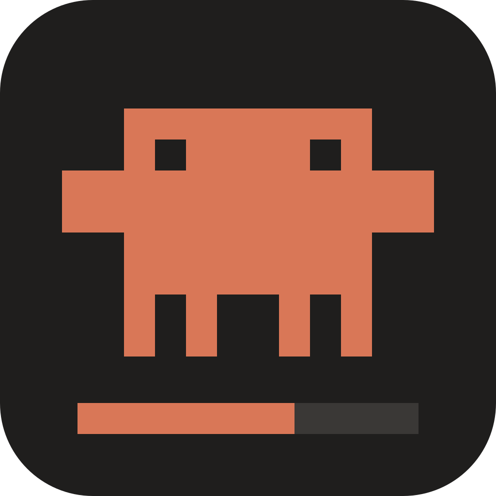
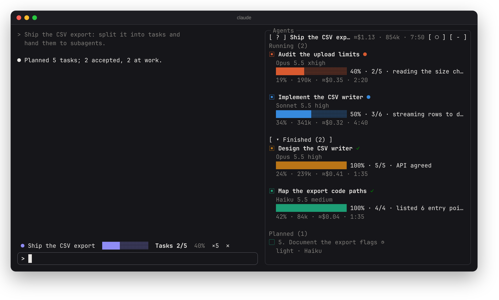
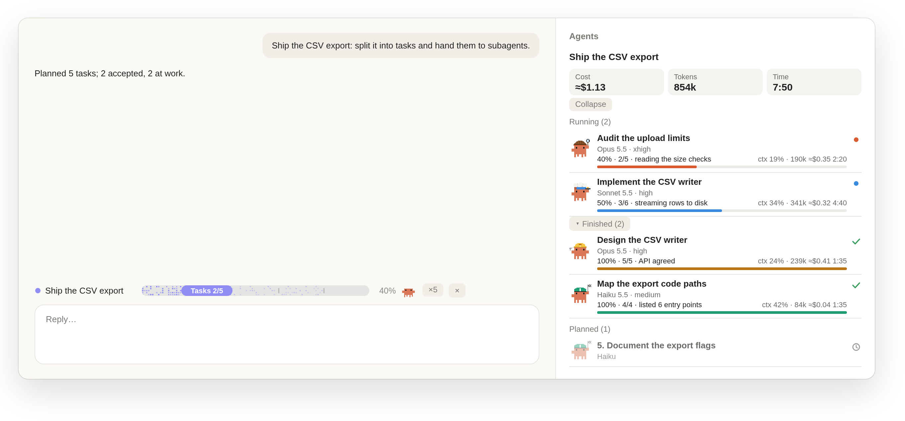

<p align="center">
  
</p>

<h1 align="center">agents-progress</h1>

<p align="center">
  <b>Veja seus subagentes trabalhando.</b><br>
  Um mod do Claude Code: uma faixa de progresso acima do prompt e um painel ao vivo de cada subagente,<br>
  com modelo, esforço, progresso da tarefa, contexto, custo estimado e tempo.
</p>

<p align="center">
  <a href="LICENSE"></a>
  
  
</p>

<p align="center">
  <a href="README.md">English</a> · <b>Português (Brasil)</b>
</p>

<p align="center">
  
  <br>
  <sub>Montado a partir da saída do mod no terminal, para um fluxo de exemplo; a janela em volta é ilustrativa.</sub>
</p>

> O mod fala inglês, português e russo. As imagens estão em inglês; com `language` em `pt` (ou o Claude Code em português), o painel e a faixa aparecem em português.

## O que ele traz

- **Uma faixa de progresso** acima do prompt: o título do fluxo, a fase, as tarefas aceitas sobre as planejadas e um botão com o tamanho da equipe que abre o painel. Fica abaixo da faixa de qualquer outro plugin.
- **Um painel de agentes** (`/agents-info`) que abre sozinho quando um subagente começa: execuções em andamento, concluídas e planejadas, cada uma com modelo e esforço, os próprios passos, ocupação do contexto, tokens, custo estimado e tempo, e os totais da sessão.
- **Uma cor por tier.** Cada execução ganha a cor do seu tier (Fable, Opus, Sonnet, Haiku), para ler a equipe de relance; no app desktop ela também veste um caranguejo em pixel com a fantasia do tier.
- **Execuções de workflow** se juntam numa linha que você abre, e uma execução iniciada por outro subagente fica recuada logo abaixo dele.
- **Terminal e app desktop.** As mesmas linhas, desenhadas como texto no terminal e como imagens no app desktop do Claude.
- **Inglês, português e russo**, seguindo o idioma configurado no Claude Code.

## Instalação

No prompt de uma sessão do Claude Code no terminal:

```
/plugin install agents-progress --marketplace fabiopbarbieri/agents-progress
```

Responda `y` para adicionar o marketplace e escolha um escopo. Ou, de um shell:

```bash
claude plugin marketplace add fabiopbarbieri/agents-progress
claude plugin install agents-progress@agents-progress
```

- **Claude Code 2.1.286 ou posterior.** Mods rodam a partir da 2.1.286 no app desktop e da 2.1.287 no terminal (`engines` em `.claude-plugin/plugin.json`; o Claude Code lê essa faixa a partir da 2.1.323, e as versões anteriores a ignoram). Recursos que vieram depois no Claude Code se recolhem numa versão mais antiga; veja [Versões do Claude Code](#versões-do-claude-code).
- **App desktop.** Ele não tem o comando `/plugin`: instale pelo terminal, e o mod carrega também nas sessões locais do app.
- **As opções são opcionais.** A instalação pode avisar que não estão definidas; os padrões valem até você mudá-las em `/config`.

## Como funciona

1. Antes de delegar, o Claude carrega a skill do mod e reporta o plano pela ferramenta `progress`: título, fase e tarefas. A faixa aparece.
2. O mod acrescenta ao prompt de cada subagente um parágrafo curto pedindo que ele reporte os próprios passos pela ferramenta `step`. O painel mostra a barra de cada execução enchendo.
3. A cada resultado que o Claude aceita, ele reporta, e a faixa conta. Quando o fluxo é reportado como concluído, a faixa sai de cena 10 segundos depois.

Execuções que nunca chamam `step`, ou trabalho que ninguém planejou, aparecem mesmo assim no painel: modelo, ocupação do contexto (em cinza), tokens, custo e tempo vêm do próprio engine.

## O painel de agentes

`/agents-info` abre e fecha o painel. Ele abre sozinho quando qualquer subagente começa, uma vez por período de atividade (uma execução iniciada quando nenhuma rodava) ou uma vez por fluxo reportado, então fechá-lo vale até lá. Mostra os subagentes da sessão, entre fluxos: os em execução, os dez últimos concluídos (um botão `+N earlier` abre o resto) e os planejados. Os totais contam todas as execuções.

- **Abrir uma transcrição.** No terminal, pressionar o título de uma execução põe a transcrição dela na vista principal, e pressionar a execução em vista traz a conversa principal de volta; `↩ Main conversation` (`m`) também. A execução em vista fica marcada. O app desktop não troca a vista principal para um agente, então o painel dele não desenha esse botão.
- **Execuções aninhadas.** Uma execução que outro subagente iniciou fica logo abaixo dele, recuada.
- **Execuções de workflow.** Uma execução da ferramenta Workflow é uma linha com o nome do workflow: agentes que responderam sobre os iniciados como barra, com tokens, custo e tempo somados. O botão `▸` (o título, no terminal) abre os agentes abaixo dela, cada um com os próprios passos assim que os reporta. A faixa conta a execução uma vez.
- **Execuções acordadas.** Uma execução que respondeu e é acordada de novo aparece em execução desde o início do novo turno.
- **Quatro linhas por execução** no terminal: o nome; modelo e esforço (`Opus 5.5 high`); a barra com os passos da tarefa; depois fatia de contexto, tokens, custo e tempo.

### Teclas

Com o painel em foco:

| Tecla | Faz | Onde |
| --- | --- | --- |
| `c` | Recolhe ou expande o painel (`[ − ]` / `[ + ]` no terminal) | ambos |
| `f` | Dobra ou desdobra as execuções concluídas | ambos |
| `e` | Abre ou fecha as concluídas mais antigas | ambos |
| `s` | Vista simples: cada execução só com nome e barra (`[ ○ ]`); de novo para os detalhes (`[ ● ]`) | terminal |
| `m` | Volta à conversa principal | terminal |
| `?` | Lista estas teclas (o botão no canto superior esquerdo do painel) | terminal |
| `Esc` | Fecha o painel, a partir do painel ou de um prompt ocioso e vazio | ambos |

No terminal os botões com tecla vêm emoldurados, então nenhum prefixo de tecla (`c:`) aparece antes dos rótulos. Enquanto um diálogo ou um campo acima do prompt cobre o prompt, a ajuda do `?` diz para focar o painel quando o prompt estiver livre (Claude Code 2.1.323).

<details>
<summary><b>Painéis estreitos</b></summary>

Um painel estreito mantém inteiros os botões do cabeçalho. A partir do Claude Code 2.1.305, um painel encaixado fica dentro de 45% do terminal: 48 colunas em 110, 53 em 120.

- O nome do fluxo cede primeiro, e some quando sobrariam menos de 12 células dele, já que a faixa nomeia o fluxo.
- Depois a palavra `tokens`, a contagem de tokens e o tempo.
- A última linha de uma execução perde os tokens de contexto antes do tempo.

</details>

### No app desktop

<p align="center">
  <picture>
    <source media="(prefers-color-scheme: dark)" srcset="assets/desktop-dark.png">
    
  </picture>
  <br>
  <sub>O mesmo fluxo nos desenhos do próprio mod para o desktop; o app em volta é ilustrativo.</sub>
</p>

Lá cada linha é uma imagem, com um caranguejo em pixel cuja fantasia mostra o tier. As teclas são as mesmas, sem `s`, `m` e `?`.

## Tiers

O tier de uma execução escolhe a cor e, no app desktop, o caranguejo. Um tipo de agente com o nome de um tier (`careful`, `plugin:careful`) prevalece; senão, o modelo decide:

| Tier | Modelo | Cor |
| --- | --- | --- |
| `fable` | Fable | violeta |
| `heavy` | Opus em esforço xhigh ou max | laranja |
| `careful` | Opus abaixo de xhigh | âmbar |
| `medium` | Sonnet | azul |
| `light` | Haiku | verde |

O esforço é aquele em que cada requisição ao modelo rodou, então uma execução segue `CLAUDE_CODE_SUBAGENT_EFFORT` (Claude Code 2.1.316) quando nada mais define um nível.

**Tarefas heavy em xhigh.** Com `heavyEffort` ligado, uma execução cuja descrição corresponde a uma tarefa planejada como `heavy` roda cada requisição em esforço xhigh (max continua max), acima de `CLAUDE_CODE_SUBAGENT_EFFORT` e do nível da sessão, e por isso mostra o caranguejo e a cor de `heavy`. Desligado por padrão. Precisa do Claude Code 2.1.309, e fica de lado enquanto `CLAUDE_CODE_EFFORT_LEVEL` força um nível.

## Configurações

Defina em `/config`.

| Opção | Valores | Padrão | O que faz |
| --- | --- | --- | --- |
| `language` | `auto`, `en`, `pt`, `ru` | `auto` | O idioma do painel. `auto` segue o idioma do Claude Code, depois o locale do sistema. |
| `stepBrief` | `on`, `agents`, `off` | `on` | `on` pede a todo subagente que reporte os passos, inclusive os agentes de um workflow. `agents` pede só aos subagentes que a ferramenta Agent inicia, deixando os prompts de um script de workflow como escritos. `off` deixa todo prompt como escrito. Cada reporte é mais uma requisição ao modelo no subagente, então um workflow com muitos agentes paga isso muitas vezes: escolha `agents` para poupar. |
| `heavyEffort` | `on`, `off` | `off` | `off` deixa o esforço de cada subagente como o Claude Code escolhe; o mod não define modelo nem esforço. `on` roda em xhigh os subagentes de tarefas planejadas como `heavy`, o que gasta mais tokens por requisição. |

## Ferramentas e skill

| Nome | Usada por | Para |
| --- | --- | --- |
| `mcp__agents-progress__progress` | a sessão que delega | O plano, a fase e as tarefas aceitas. |
| `mcp__agents-progress__step` | cada subagente | Os próprios passos (`done`, `total`, `note`). |
| `agents-progress:reportar-progresso` (skill) | o Claude, antes de delegar | Quando chamar `progress`: primeiro o plano, depois cada tarefa aceita. Não aparece no menu `/`. |

- A partir do Claude Code 2.1.293, `step` está listada desde o primeiro prompt, então um subagente a chama sem um ToolSearch antes. O parágrafo que o mod acrescenta a cada prompt só cita o ToolSearch num engine anterior à 2.1.293.
- Os agentes de um workflow recebem esse parágrafo a partir do Claude Code 2.1.300. Antes disso, como num app desktop com engine mais antigo, eles mantêm os prompts como o script os escreveu.
- Uma execução que não reporta os passos mostra a ocupação do contexto em cinza.
- Nenhuma das ferramentas desenha uma linha na transcrição, já que a faixa e o painel mostram o que elas reportam; uma chamada que falhou ainda aparece.

## Bom saber

- **O custo é uma estimativa** a partir das contagens de tokens e da tabela `PRICES` em `hooks/register.tsx`, não uma fatura.
- **Os resumos de progresso do próprio Claude Code não são usados.** A faixa e o painel desenham a partir das ferramentas do mod e das contagens de tokens de cada execução. Para poupar as requisições que escrevem esses resumos, defina `CLAUDE_CODE_DISABLE_AGENT_PROGRESS_SUMMARIES=1` (Claude Code 2.1.318).

## Versões do Claude Code

O mod roda a partir do piso abaixo. O que veio depois no Claude Code se recolhe sem alarde num engine mais antigo; o app desktop roda o próprio engine, que pode ficar atrás da CLI.

| Claude Code | O que traz ao mod |
| --- | --- |
| 2.1.286 (desktop) · 2.1.287 (terminal) | Mods rodam: a faixa, o painel, as duas ferramentas e a skill. |
| 2.1.293 | `step` listada desde o primeiro prompt, e os subagentes dispensam o ToolSearch. |
| 2.1.300 | Os agentes de um workflow são orientados a reportar os passos. |
| 2.1.305 | Um painel encaixado fica dentro de 45% do terminal, e o cabeçalho se ajusta a ele. |
| 2.1.309 | `heavyEffort` pode subir uma tarefa `heavy` para xhigh. |
| 2.1.316 | As execuções seguem `CLAUDE_CODE_SUBAGENT_EFFORT`. |
| 2.1.318 | `CLAUDE_CODE_DISABLE_AGENT_PROGRESS_SUMMARIES` poupa os resumos que o mod não usa. |
| 2.1.323 | `engines` é lido na instalação, atualização e carga; a ajuda do `?` sabe quando o prompt está coberto; `validate` checa os tipos dos testes. |

## Desenvolvimento

Para trabalhar nele, adicione seu clone como marketplace (`claude plugin marketplace add <caminho do clone>`): a origem da entrada é relativa, então a sessão lê o plugin dessa pasta. Edite e rode `/reload-plugins`.

### Verificações

```bash
claude plugin validate . --strict
claude plugin test .
npx -p typescript@5 tsc -p .
```

- `claude plugin test` roda `tests/*.test.ts` no host do próprio engine, nas superfícies terminal e desktop; `tests/kit.ts` faz o papel do engine por baixo do mod. Ele confere os hooks e as árvores que eles devolvem, não como uma superfície as pinta.
- A partir do Claude Code 2.1.323, `validate` checa os tipos de `hooks/` e `tests/` contra os tipos da API do engine, e `--strict` falha em qualquer erro de tipo. `tests/kit.ts` monta requisições de render completas (`BAND`, `PANE`) para os testes passarem nessa checagem. Rode com a 2.1.323 ou posterior: uma CLI mais antiga avisa sobre o campo `engines`, que não conhece, e `--strict` falha nesse aviso.
- `scripts/readme-images/build.sh` redesenha as imagens de `assets/` a partir da saída do próprio mod para um fluxo de exemplo (precisa de Python 3, Chrome headless e ImageMagick).
- `tsc` lê os tipos da API que o engine deixa em `.claude-plugin/types/` (ignorado pelo Git) quando uma sessão interativa carrega o mod da pasta dele, como faz `claude --plugin-dir .`; uma execução `claude -p` não os deixa. Cobre só `hooks/` e `types/`.

## Versionamento

[Semantic Versioning 2.0.0](https://semver.org/lang/pt-BR/), com `version` em `.claude-plugin/plugin.json` como fonte única:

- **Major**: uma mudança que quebra o que outros usam: as entradas ou respostas das ferramentas, o contrato `$.state` em `types/index.d.ts`, uma opção de `userConfig` removida ou renomeada, o comando `/agents-info`.
- **Minor**: um recurso que mantém tudo isso funcionando.
- **Patch**: uma correção, um ganho de desempenho ou uma mudança de documentação.

Para lançar: mova `version`, adicione a seção ao [`CHANGELOG.md`](CHANGELOG.md), commite, depois `claude plugin tag . --push` (tag `agents-progress--v<version>`) e uma release no GitHub a partir dessa seção.

## Créditos

Derivado do [savvy-progress](https://github.com/johnnyvizz/claude-kit/tree/main/plugins/savvy-progress), de johnnyvizz. Distribuído sob a [licença MIT](LICENSE).
